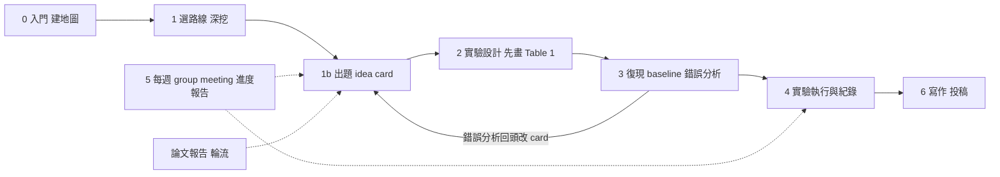

# Lab-Hub

由國立臺灣師範大學 [李鴻欣 Hung-Shin Lee](https://web.ntnu.edu.tw/~hslee/) 助理教授所設計的研究方法教材，給碩博班研究生。它教的是**從拿到一個題目到投出一篇會議論文**這條路上每一步怎麼做：怎麼用 AI 建文獻地圖並核對、怎麼寫出自己的 idea、怎麼設計實驗、怎麼復現與記錄、怎麼在 group meeting 報進度與報論文。目標不是「把題目做對」而已，是**投 top conference**——所以每一站都有「審稿人會怎麼看」的那一段。

教材是用來照著做的，不是用來讀過就算。每份都有步驟、要自己填的欄位（用 `〔〕` 標示）、產出長什麼樣、怎麼核對，以及「要先問教授的事」。

## 會議資訊

語音與 NLP 的主要會議，**以 2027 年 3 月底前截稿的為主**，按截稿日排序。查證日期 2026-10-22；截稿日常改，**填 Round 2 的「目標會議與截稿日」時自己到官網再查一次**，不要讓 AI 查。標「預估」的是官網還沒公布、從往年推的。**預設挑戰長論文**：「類型」欄加粗的是預設目標，怎麼選見表後。

| 截稿 | 會議 | 類型 | 會議日期與地點 | 備註 |
|---|---|---|---|---|
| **2027-01-04** | [ACL Rolling Review 1 月週期](https://aclrollingreview.org/dates) | NLP，**長論文**（也收短論文） | 審完可 commit 到 [ACL 2027](https://2027.aclweb.org/)（commit 截止待公布；2027-08-17～22 [日本京都](https://www.google.com/maps/search/?api=1&query=Kyoto%2C+Japan)，主會 08-20～22） | 截稿日以 ACL 2027 官網為準（ARR 的日期表還只寫「2027 年 1 月」）。ARR 是先審再選會議；一個週期沒過可以帶著審稿意見投下一個週期。口語語言處理、語音＋LLM 的題目可投 |
| 2027-01 下旬（預估：摘要約 1/16、全文約 1/22；待官網公布） | [ICML 2027](https://icml.cc/) | ML 主會，**長論文** | 2027 年 7 月（預估），南美洲（城市待公布） | 要概念層的主張加完整實驗；第 2 站預設的長論文格式就是為這類 |
| 2027-02-06 | [EUSIPCO 2027](https://eusipco2027.de/) | 訊號處理（含語音與音訊 track），5 頁（含參考文獻） | 2027-08-30～09-03 [德國達姆城](https://www.google.com/maps/search/?api=1&query=Darmstadt%2C+Germany) | EURASIP 主辦、IEEE SPS 協辦；和 Interspeech 只差 3 天，同一篇只能投一邊——適合偏訊號處理、增強、前端的題目，或 Interspeech 沒把握時的替代 |
| 2027-02-09（更新至 02-16） | [Interspeech 2027](https://interspeech2027.org/) | 語音，4 頁 | 2027-08-29～09-02 [巴西聖保羅](https://www.google.com/maps/search/?api=1&query=S%C3%A3o+Paulo%2C+Brazil) | 語音領域的主場；4 頁，是長論文修剪後的退路，不是預設目標（第 6 站 §4.3）；通知 2027-06-02 |
| 2027-03 下旬（預估；2026 年是摘要 3/26、全文 3/31） | [COLM 2027](https://colm.cc/) | 語言模型，**長論文** | 待公布 | 語音＋LLM 的題目可投 |

**本週期已過、下一屆要等的**：ARR 10 月週期（截稿 2026-10-12；已經投了的人，2026-12-23 前 commit 到 NAACL 2027〔2027-06-01～05 [美國舊金山](https://www.google.com/maps/search/?api=1&query=San+Francisco%2C+CA%2C+USA)〕或 COLING 2027〔2027-05-09～14 [中國澳門](https://www.google.com/maps/search/?api=1&query=Macau)〕）、ICASSP 2027（截稿 2026-09-23，2027-05-16～21 [加拿大多倫多](https://www.google.com/maps/search/?api=1&query=Toronto%2C+Canada)；下一屆約 2027 年 9 月截稿）、ICLR 2027（截稿 2026-09-25，2027-04-26～30，地點待公布；下一屆約 2027 年 9 月）、EACL 2027（ARR 8 月週期，commit 已截止）。

**3 月底之後**：[ASLI 2027](https://2027.ieeeasli.org/)（**已公布**：截稿 2027-04-21、通知 07-28、camera-ready 08-11；2027-11-29～12-04 [新加坡](https://www.google.com/maps/search/?api=1&query=Singapore)，與 ICIP 2027 合辦。ASLI 是 IEEE SPS 把 ASRU 與 SLT 合併成的新會議，**以後沒有 ASRU／SLT**；challenge 提案截止 2026-12-03，查證 2026-10-22）。以下截稿日都是預估：NeurIPS 2027（摘要約 05-14、全文約 05-21；官網只公布在歐洲）、EMNLP 2027（ARR，約 5–6 月）、ICASSP 2028（約 9 月；會議已公布：2028-05-28～06-03 [日本東京](https://www.google.com/maps/search/?api=1&query=Tokyo%2C+Japan)）。

怎麼選：**預設挑戰長論文，第一篇也是**——目標是 ACL 主會（經 ARR）、EMNLP、ICML、NeurIPS、ICLR、COLM 這類正文 8 頁以上的會議，第 2 站設計實驗、第 6 站寫作都照長論文做（多資料集、分析表、代價表、失敗案例，見第 2 站 §2.3）。4 頁的 Interspeech、ICASSP 與 5 頁的 EUSIPCO 是退路：長論文的實驗修剪成 4 頁做得到，反過來做不到（第 6 站 §4.3）。投哪一個、要不要改投 4 頁，由教授定。

## 研究路徑

- 實線是主線，每站一份教材。
- 第 5 站「進度報告」從第 2 站起每週做；第 0、1 站不做每週報告，只在 Round 1 和 Round 2 做完各報一次。論文報告在 partner 組內輪流，讀到的論文會回到 1b 變成新的 card。
- 第 3 站做完錯誤分析要回 1b 改 card——出題不是一次性的，最能投的 idea 通常來自復現時看到的失敗。

## 一個會議週期大約長這樣（示例）

> 示例，以教授定的目標會議與截稿日為準；Round 2 的 one-pager 會從截稿日倒推出你自己的版本。

| 週 | 站 | 做什麼 | 結束時交什麼 |
|---|---|---|---|
| 1–4 | 0 | 建 repo、跑 Round 1、核對、親讀 5 篇 | 報告投影片＋§9 問題，教授定路線 |
| 5–6 | 1 | Round 2、核對、補盲區 | 報告投影片＋one-pager，教授定題目與里程碑 |
| 7–8 | 1b＋2 | 寫 3–5 張 card，教授挑一張；畫 Table 1、消融表、method figure、論文骨架 | 設計文件，教授審過 |
| 9–11 | 3 | 復現必備 baseline 到對上數字；錯誤分析 100 個樣本 | 復現紀錄、錯誤分析；card 改版 |
| 12–13 | 2 | Pilot | 假設成立／放棄；不成立回 1b |
| 14–21 | 4 | 主實驗、消融；每週填 Table 1 | Table 1 與消融表填滿 |
| 22–24 | 4 | 長論文的分析：按條件拆結果、代價表、失敗案例（第 2 站 §2.3 預留的那三樣） | 分析表、代價表、失敗案例 |
| 25–30 | 6 | 三張表給教授審、由內往外寫、AI 冷讀與 partner 盲讀 | 截稿前 10 天交教授，教授接手投稿 |
| 每週 | 5 | 進度報告（第 7 週起）；論文報告輪流 | — |

大約 7 個月，對應一篇長論文（第 6 站從截稿前 6 週開始寫）。改投 4 頁的 Interspeech 或 ICASSP 大約少 4–8 週，但要不要改投由教授定，不是時間不夠時自己砍。哪一站落後 2 週以上，就是第 5 站「月度停損」要討論的時候。

## 教材清單（照路徑順序）

| 站 | 教材 | 什麼時候用 | 做完會有什麼 |
|---|---|---|---|
| 0 | [Deep Research 第一輪：建地圖](guides/deep_research/round1_map.md) | 教授給了一個題目或一段應用情境，你完全不熟，要在一個月內看懂全貌 | 核對過的地圖報告 `_r1_checked.md`、12 段的報告投影片（Quarto） |
| 1 | [Deep Research 第二輪：深挖路線](guides/deep_research/round2_dive.md) | 和教授討論、選定一條技術路線後，以投一篇會議論文為目標 | `_r2_*.md`、13 段的報告投影片（Quarto）、教授改過的研究提案 one-pager |
| 1b | [出題：idea card 與 idea log](guides/ideation/idea_card.md) | Round 2 之後第一次寫；之後每次進度報告帶一張新的或改過的 | idea card、累積的 idea log（退掉的也留）、預測紀錄 |
| 2 | [實驗設計：先畫 Table 1](guides/experiment_design/design_table1.md) | 教授挑定你的 card 之後、寫任何程式之前 | Table 1 空表、消融表、方法圖、論文骨架、一頁決策紀錄（教授審過才開始寫程式） |
| 3＋4 | [復現 baseline、錯誤分析、實驗紀錄](guides/experiment_log/reproduce_and_log.md) | Table 1 審過之後，一直到投稿 | `results.csv`、實驗日誌、復現紀錄、錯誤分析、寫給外人看的 README |
| 5 | [進度報告：group meeting 怎麼報](guides/progress_report/group_meeting.md) | 每週（第 2 站起） | 8 頁 Quarto 投影片（含講稿）、GitHub Issue 上的教授回饋 |
| 貫穿 | [論文報告：把一篇論文變成投影片與講稿](guides/paper_reading/paper_to_slides.md) | 輪到你報論文時；每週 2 篇淺讀 | 13 段英文投影片（每段頁數不限，中文講稿）、一頁核對紀錄（有官方 repo 的附程式對照）、reading log |
| 產學 | [產學分支：同一條路，產學計畫多做什麼](guides/industry_project/industry_track.md) | 參與產學計畫的人，拿到產業需求的第一天 | 需求規格表、驗收紀錄、給產業方的月報、研究測試報告、可以直接交付的專案 repo |
| 6 | [寫作：從填滿的 Table 1 到投稿](guides/paper_writing/table1_to_paper.md) | 主實驗與消融跑完，截稿前約 6 週（長論文） | 一節一檔的 LaTeX 論文（repo 的 `paper/`）、投稿規定表、主張–證據表與篇幅預算（教授審過才寫正文）、每個數字的出處、AI 冷讀與 partner 盲讀的處理表 |
| 總表 | [要問教授的事](conventions/ask_professor.md) | 任何時候不確定「這該不該自己決定」 | 各站問題按時間排的一頁索引 |
| 慣例 | [審稿對帳](conventions/review_reconciliation.md) | 審稿意見回來的 48 小時內 | 一張「每條意見對回當初決策」的表；我容易漏的那一類 |

## 先讀哪份

- **剛進實驗室、教授剛給題目**：先從範本建自己的研究 repo（第 0 站操作方法第 0 步），然後第 0 站。跑完核對完，做成投影片在 group meeting 報一次，問 §9 的問題，教授定路線，再看第 1 站。
- **已經有題目、要開始做實驗**：1b → 2 → 3＋4，照順序，不要跳。第 2 站的 Table 1 沒經教授審過不要寫程式。
- **主實驗跑完、要開始寫論文**：第 6 站。先做三張表給教授審，再動筆；分析的「為什麼」和 Limitations 自己寫。
- **這週要報進度**：第 5 站。它假設你已經在做第 2–4 站的事。
- **這週輪到報論文**：貫穿那份。每三次輪到一次審稿預測練習（同一份教材 §10）。
- **參與產學計畫**：先讀產學分支 §0–§3（分工、路徑、需求規格表、資料紀律），再照各站教材做；每站多做的事在 §4，月報在 §5。
- **不確定某件事該自己決定還是問教授**：總表。

## 四件先講清楚的事

- **AI 產出的報告是地圖，不是文獻。** 你在報告、投影片、論文裡引用的每一篇，都必須是你自己開過、讀過的。每份教材都有「怎麼核對」一節，那一節不是選讀。
- **AI 產出要標明。** 和教授討論時，說清楚哪些是 AI 的產出、哪些是你核對過的、哪些是你自己的判斷。教授要的是你的判斷。
- **題目、資料、GPU、目標會議由教授決定。** 教材裡會告訴你哪些問題要帶去問；不要自己猜。
- **你的 card 先講，教授後講。** Group meeting 固定順序：你報 card → 大家預測教授會怎麼判 → 教授才講。知道教授最後會給 idea 就會停止自己想，所以順序不能反。

## 你會用到的工具

| 工具 | 用在哪 | 哪份教材教 |
|---|---|---|
| AI 的 Deep Research 功能 | 第 0、1 站建地圖與深挖 | 第 0、1 站 |
| AI 的一般對話 | 核對報告、發散 idea、壓力測試 card、生投影片草稿、解釋看不懂的段落——每份教材都有「AI 怎麼用」與「不可以」 | 各站 |
| GitHub（lab 的 org `SigSpeechAI-NTNU`） | 你這個題目的一切：Deep Research 報告、設計文件、程式碼、實驗紀錄、投影片、每週報告的 Issue。拿到題目第一天就從範本 [`student-template`](https://github.com/SigSpeechAI-NTNU/student-template) 建，一題一個 repo | 第 0 站建，第 3＋4、5 站用 |
| uv | 所有 Python 環境：`uv sync`、`uv add`、`uv run`；不用 conda 或裸 pip | 第 3＋4 站 §2 |
| Quarto | Deep Research 兩輪、進度與論文的投影片（qmd → html，含講稿，按 `S` 看講稿）；樣式表 `theme.scss` 在範本 repo 的 `reports/`，用法見第 5 站 §4.4 | 第 0、1、5 站、論文報告 |
| Markdown | 日誌、idea log、決策紀錄、核對紀錄——所有給自己看的紀錄 | 各站 |
| LaTeX（latexmk）、BibTeX | 論文：一節一檔，放 repo 的 `paper/`；BibTeX 從出版方頁面匯出，不跟 AI 要 | 第 6 站 |
| arXiv、Google Scholar、OpenReview | novelty 檢查、Scholar alert、審稿預測練習 | 1b、第 1 站、論文報告 |

## 授權

本 repo 的教材以 [CC BY-SA 4.0](LICENSE) 授權：可以自由使用、修改、再散布，包括商業用途，條件是註明出處（李鴻欣，SigSpeechAI-NTNU Lab-Hub），而且改作後的版本要以同樣的 CC BY-SA 4.0 授權釋出。其他實驗室要拿去改成自己的版本，歡迎。
