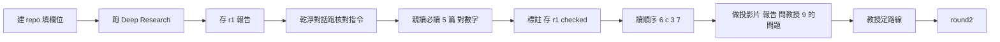

# Deep Research 第一輪：建地圖（共用，v3.7，2026-10-22）

> 用途：用 AI 的 Deep Research（深度研究）功能，對語音 AI、NLP／LLM 等領域下的**細分題目**建一張地圖。題目可以是既有名稱（例：contextual biasing STT），也可以是幾句話描述的應用情境（例：使用者講話夾雜人名與專有名詞時，語音辨識常認錯）；後者由報告 §1 對應成文獻裡的正式名稱。
> 這一輪**不分教授或學生**：讀者一律設定為「有 ML 基礎但不熟此題」，產出的報告可以直接共用。看完報告、選定一條技術路線後，跑第二輪 `round2_dive.md`（也是共用）。
> 本檔含：第一輪指令、核對指令、第一輪的操作方法、報告投影片。〔〕內為每次要填的欄位。
> **參與產學計畫的人**：題目欄寫你自己改寫的一般情境，不貼產業方的需求文件或名稱；這一站多做的事見[產學分支](../industry_project/industry_track.md) §3.2、§4。

---

## 第一輪指令

```
今天是〔YYYY-MM-DD〕，所有「近 N 年／近 N 個月」以此日期為基準。

我是〔身分，例：大學教授／碩士班二年級研究生〕，所在實驗室做〔實驗室大方向，例：語音 AI〕。
我要了解「〔細分題目名稱（英文原名＋中文）；或者用幾句話描述一個應用情境〕」，目前對它不熟。
請做深度研究報告，讀者是有 ML 基礎但完全不熟此題的人。
這一輪的目的是看清全貌，不是選題；可行性、人力與時程的篩選會在下一輪用具體背景做。

結構（以全面與深入為優先；若篇幅受限：§1、§2、§3、§4、§6、§7、§9 不得縮減；可縮 §5、§8）：
1. 問題定義：若我給的是情境描述而不是既有題目名稱，先把它對應到文獻中的正式名稱
   （可能不只一個，各自說明對應理由，之後以你選定的名稱為準搜尋）。
   這個題目在解什麼、為什麼難、在整個〔語音 AI／NLP〕領域裡的位置；
   列出容易混淆的相鄰概念，用 Mermaid 概念邊界圖說明差異
2. 入門骨架：近三年的 survey／tutorial 論文，以它們為骨架；沒有 survey 就明說，改以 2–3 篇奠基論文為骨架。
   另給一份「一個月閱讀順序」：先讀哪篇、為什麼、讀完要能回答什麼問題
3. 技術路線地圖：主要技術路線 3–6 條，每條說明核心機制、代表論文（近四年）、
   優缺點；用 Mermaid 演進樹畫出分支、合流與被取代的關係。
   路線名稱請固定，下一輪會沿用
4. 評測現況：常用資料集、指標、目前 SOTA。表格欄位固定為：
   資料集／指標／數字／來源論文（URL）／測試條件（模型規模、是否用外部資料或語言模型、streaming 與否等）／數字來源類型（論文自報、公開排行榜、第三方復現）／日期。另指出評測本身的問題
5. 學術與工業動態：相關頂會近三年論文量趨勢、活躍團隊、開源實作與工具鏈、
   已產品化的公司與場景。每個「數量」附查詢式（資料庫、關鍵字、日期範圍、筆數）；
   沒有查詢式的數量不要寫
6. 成熟度判斷：萌芽／快速成長／成熟／被更大範式取代中，判斷依據為何
7. 未解問題與空缺：文獻中反覆提到但未解決的問題，每項附至少一篇提到它的論文；
   繁體中文／台灣語境的空缺另列。這一輪不做可行性篩選、不估人力與時程
8. 商機：付費場景、現有產品痛點、學研轉化形態與風險
9. 切入前要確認的問題：列出 5–8 個報告答不了、必須由實驗室內部（指導教授、
   資料持有者、設備管理者）回答的問題，例如有哪些資料、想走哪條路線、
   和既有工作的關係；每個問題附「為什麼這個問題會影響選題」

要求：
- 以英文來源為主：arXiv、頂會論文、官方技術文件；不納入中文來源。只列你實際開啟過的
  論文，每篇附開啟的 URL（arXiv 或 DOI 頁面）。僅從搜尋摘要或他文引用得知、未開原文者，
  另列一區並標「二手」。不要補全或猜測編號
- 每個結論性主張標記：【共識】多篇文獻一致／【單篇】只有一篇來源／【推論】你的推導。
  不確定處明說
- 讀者不熟此題，解釋所有縮寫與術語，結尾附 glossary
- 示意圖用 Mermaid，總數 3–5 張，每張附一兩句說明；節點標籤不含括號、引號、斜線；
  每張圖前先用文字列出節點與邊。數字類內容一律用表格
- 以繁體中文（臺灣用語）撰寫，專有名詞保留英文。輸出 Markdown。以完整與可驗證為優先，
  不要為了精簡而省略論文
- 結尾四項：
  (a) 搜尋紀錄：用了哪些資料庫與查詢式、哪些沒找到或無法存取
  (b) 一頁摘要，並附口頭報告的骨架：每節一兩句要講的重點
  (c) 推薦 3 條值得進第二輪的技術路線（是路線，不是題目），各附理由
  (d) 入門必讀 5 篇，全部須為已開啟原文
```

---

## 核對指令（每輪報告出來後，另開乾淨對話使用；第二輪也用這份）

```
附件是一份由 AI 產生的深度研究報告。請只做核對，不要補內容、不要改寫、不要評論好壞。

1. 逐篇檢查報告列出的論文：用標題與作者搜尋（不要憑記憶判斷，開不了就寫「無法核對」），確認
   (a) 論文存在 (b) 報告給的 URL／編號指向同一篇 (c) 報告對它的描述與該論文摘要相符。
   輸出表格：報告中的位置／標題／存在？／URL 正確？／描述相符？／備註
2. 逐一檢查報告中所有表格內的數字：開啟來源，確認數字、資料集、測試條件與報告一致。
   輸出表格：報告中的位置／數字／來源是否可開啟／是否一致／備註
3. 列出報告中所有標「二手」、無 URL、或標【推論】但寫得像事實的項目
4. 結尾統計：核對了幾項、幾項通過、幾項有誤、幾項無法核對
```

---

## 操作方法（第一輪）

整個流程一張圖：



### 先講兩件事
- **報告是地圖，不是文獻。** 任何要引用的論文都必須自己開過、讀過；報告裡的清單只告訴你去哪找。
- **AI 產出要標明。** 拿報告討論時，說清楚哪些是 Deep Research 的產出、哪些是核對過的、哪些是自己的判斷。

### 事前準備
0. **先建自己的研究 repo**：到 `SigSpeechAI-NTNU/student-template` 按 Use this template，命名 `〔名字〕_〔題目簡稱〕`，private，教授加為 collaborator。**沒做過的照範本 README「第 0 天：從零到第一個 commit」十步做**，約 20 分鐘。這個題目從現在起的所有東西——Deep Research 報告、設計文件、程式、紀錄、投影片——都放這個 repo。
1. 在你用的 AI 工具開一個獨立的 Project（例如「Deep Research」）或不掛 Project 的新對話。若實驗室有自己的 Project 規範，不要在那個 Project 裡跑，指令會互相干擾。
2. 填欄位：日期、身分、實驗室方向、題目、領域。題目可以是既有名稱，也可以是幾句話描述的應用情境（誰在什麼狀況下遇到什麼問題）；後者由報告 §1 對應成文獻裡的正式名稱，第二輪就用那個名稱。

### 跑
3. 新對話，開啟 Deep Research 功能，貼上第一輪指令全文。
4. 工具可能先問幾個澄清問題（範圍、語言、年代）——回答後才會開始搜尋。等待幾分鐘到數十分鐘，可以離開。
5. 存成 `research/<題目>_r1_<日期>.md`（在你的 repo 裡）。用 VS Code＋Mermaid 外掛或 Obsidian 預覽圖；畫不出來的圖之後單獨請 AI 重畫，不要重跑整份研究。

### 核對
6. 另開乾淨對話，附上報告，貼「核對指令」。
7. 拿到核對表後，**自己親手開**「入門必讀 5 篇」，至少讀完摘要與 introduction；§4 表格挑 2–3 個最關鍵的數字對一次。核對指令抓得到「不存在」與「對不上」，抓不到「存在但不重要」——那要靠人讀。
8. 在報告裡直接標註核對結果（例如行尾加 `[核對：URL 錯]`），存成 `research/<題目>_r1_<日期>_checked.md`。之後第二輪附的是這份。

### 讀與選路線
9. 讀的順序：§6 成熟度 → 結尾 (c) 推薦路線 → §3 路線地圖 → §7 未解問題 → 其餘。先看「要不要進」，再看「從哪進」。
10. §9 的問題清單要有人回答：學生把報告做成投影片（下面「報告投影片」），在 group meeting 報一次，報完問 §9；教授自己跑的話自己回答或決定延後。答案會成為第二輪的背景欄位。
11. 若 §6–§7 明顯薄（各只有幾行）：把第一輪拆成兩次跑——第一次只要 §1–5，第二次附上第一次的報告、只要 §6–9。指令其他部分不變。
12. 選定一條路線，**用報告裡的命名**，進 `round2_dive.md`。

---

## 報告投影片

核對完、親讀完 5 篇之後，把報告做成一份 Quarto 投影片，在 group meeting 報一次，報完問 §9 的問題（操作方法第 10 步）。報告有幾十頁，聽的人不會讀；投影片要用圖和表把這張地圖講清楚：這個題目長什麼樣、你核對到什麼程度、你自己怎麼想。

- **檔案**：複製範本 repo 的 `reports/_template_r1.qmd`，存成 `reports/<題目>_r1_<日期>.qmd`（和 `research/` 裡的報告同名）；render 出的 html 一起 commit，圖放 `reports/figs/`
- **語言**：中文；術語、方法名、資料集名、論文標題保留英文
- **時間**：不設時限，教授當場控制
- **機制**和論文報告一樣：YAML、樣式表 `theme.scss`、講稿分【講述】與【提示】（論文報告 §4.1、§4.2）；可用的樣式類別見第 5 站 §4.4
- **參與產學計畫的人**：投影片和報告一樣，不放產業方的名稱與需求原文（產學分支 §3.2）

### 三條規則

1. **只用核對過的。** 素材是 `_r1_checked.md`。核對表判為不存在、URL 錯、描述不符或無法核對的論文與數字，以及報告標「二手」的論文，都不上投影片
2. **每一列標來源。** 表格最後一欄「來源」：核對通過的寫 `[✓]{.tag .ok}`；報告的判斷或【推論】（例如成熟度）寫 `[AI]{.tag .warn}`；你自己的寫 `[我]{.tag}`。講的時候照著說：「這是 AI 的判斷」「這個我核對過」
3. **12 段固定，每段頁數不限。** 每段第一頁用下表的標題，放這一段的重點；一頁講不清楚就加頁，標題寫「段標題: 子題」（例 `## 技術路線地圖: 路線表`）。教授說跳過時，從下一段的第一頁接

### 12 段

| 段 | 第一頁標題 | 放什麼 | 出處 | 誰寫 |
|---|---|---|---|---|
| 1 | 題目一句話 | `.claim` 一句：正式名稱、在什麼情境下、解決什麼；起點是情境描述的，加一行「情境 → 正式名稱」與對應理由 | §1 | AI→核對 |
| 2 | 問題在哪裡 | **pipeline 示意圖**：任務從輸入到輸出，壞掉的那個框標紅；一個具體的失敗例子（輸入 → 錯成什麼） | §1 | AI→核對 |
| 3 | 概念邊界 | 報告的**概念邊界圖**；「相鄰概念／和本題的差別」對照表 | §1 | AI→核對 |
| 4 | 技術路線地圖 | 報告的**演進樹**；加一頁**路線表**：路線／核心機制／代表論文／優點／缺點 | §3 | AI→核對 |
| 5 | 各路線的架構 | 第一頁：第 2 段的 pipeline 圖，標出每條路線改的是哪一個框；之後**一條路線一頁架構圖**，標題「各路線的架構: 〔路線名〕」 | §3＋代表論文 | AI→核對 |
| 6 | 評測現況 | **SOTA 表**：資料集／指標／數字／測試條件／出處，只留核對過的列；加一頁評測本身的問題 | §4 | AI→核對 |
| 7 | 成熟度與動態 | 成熟度一句（`.claim`）與依據表；開源工具鏈表；論文量（附查詢式的才放，可畫成圖） | §5、§6 | AI→核對 |
| 8 | 未解問題 | 表：問題／提到它的論文／和臺灣語境有沒有關 | §7 | AI→核對 |
| 9 | 核對結果 | `.metrics` 四格：核對幾項、通過、有誤、無法核對；抓到的錯挑 2–3 個 | 核對表 | **我** |
| 10 | 親讀 5 篇 | 表：論文／我讀到的／和報告說的不一樣的地方 | (d)＋原文 | **我** |
| 11 | 我的判斷 | 報告推薦的 3 條路線（標 AI）；我傾向哪條、為什麼、沒把握的地方 | (c)＋你 | **我** |
| 12 | 要問教授 | §9 挑 5–8 題，每題附「為什麼這會影響選題」 | §9 | **我**挑 |

§8 商機不上投影片。第 9–12 段 AI 只放報告原有的清單，判斷與心得留給你寫——教授從這幾段看你讀懂多少。

### 圖與表

| 東西 | 怎麼做 |
|---|---|
| 報告裡的 Mermaid（概念邊界圖、演進樹） | 直接搬進 qmd 的 `{mermaid}` 區塊（大括號不能省，同論文報告 §4.1）。上到下（`TD`）的改成 `flowchart LR`，投影片是橫的；節點超過 12 個就拆頁 |
| pipeline 示意圖（第 2、5 段） | Mermaid `flowchart LR`。壞掉的框加 `style 〔節點〕 stroke:#dc2626,stroke-width:4px`；第 5 段第一頁在同一張圖上加路線名的節點，用虛線（`-.->`）指到它改的那個框 |
| 各路線的架構圖（第 5 段） | 每條路線同一種畫法：`flowchart LR`、輸入在左輸出在右、這條路線的核心成分加粗（`stroke-width:4px`）、邊上標資料是什麼。**畫完對代表論文的架構圖**，代表論文要自己開過；沒開過的，那頁標「架構未核對」或先不畫。也可以截代表論文的圖，但要加自己的標註（論文報告 §3「圖的規則」） |
| 失敗例子（第 2 段） | 不是框和箭頭的（一段語音被認成什麼、錯在哪幾個字）：請 AI 寫 SVG，規格照第 5 站 §4.5 |
| 數字 | 一律表格，每個數字附出處（論文與表號）。表太寬就拆兩頁，或包在 `::: {.wrap}` 讓首欄換行，不要縮字 |
| 論文量（第 7 段，選做） | 請 AI 寫 matplotlib 程式畫長條圖：圖寬 11 吋、字級 16，存成 `reports/figs/trend.svg`；程式 `trend.py` 放同一個資料夾一起 commit（`uv add matplotlib`，`uv run python reports/figs/trend.py`）。放進投影片寫 `{width=1100}`，圖下附查詢式。11 吋的 SVG 放成 1100 寬，字級 16 會變成約 22px，和表格的字一樣大 |

### 請 AI 產生草稿

附上 `_r1_checked.md`、核對表與 `_template_r1.qmd`，整段複製：

```
附件三份：Deep Research 第一輪報告的核對版（_r1_checked.md，行尾的 [核對：…] 是核對結果）、核對指令產出的核對表、投影片範本 _template_r1.qmd。
請依範本產生一份 Quarto revealjs 投影片的完整 .qmd，我會存成 reports/〔題目〕_r1_〔日期〕.qmd 直接 render。

== 總規則 ==
- YAML 逐字用範本的，只填 title／subtitle／author／date
- 段落與順序照範本，每段第一頁的 ## 標題逐字用範本的。一頁講不清楚就加頁，加的頁標題寫「段標題: 子題」；一頁一件事，不要為了放更多字而拆頁
- 投影片與講稿都用繁體中文（臺灣用語）；術語、方法名、資料集名、論文標題保留英文
- 只用報告裡核對通過的內容。核對表中任何一格是否定或「無法核對」的論文與數字、報告標「二手」的論文，一律不放
- 每張表最後一欄「來源」：核對通過的寫 [✓]{.tag .ok}；報告的判斷或標【推論】的寫 [AI]{.tag .warn}
- 每個數字註明出處（論文與表號）
- 不要補報告裡沒有的論文、數字或判斷；沒有的格子留〔〕

== 各段 ==
1 題目一句話：::: {.claim} 包一句「〔正式名稱〕是在〔情境〕下，〔解決什麼問題〕」；下方兩行：起點、對應的正式名稱與理由（報告 §1）
2 問題在哪裡：任務的 pipeline 用 Mermaid flowchart LR 畫，壞掉的那個框加 style 〔節點〕 stroke:#dc2626,stroke-width:4px；下方一行具體失敗例子（輸入 → 錯成什麼），報告沒有就留〔〕
3 概念邊界：報告 §1 的概念邊界圖搬過來，改成 flowchart LR；下方或下一頁一張表：相鄰概念／和本題的差別／來源
4 技術路線地圖：報告 §3 的演進樹搬過來，改成 flowchart LR；加一頁「技術路線地圖: 路線表」：路線／核心機制／代表論文／優點／缺點／來源
5 各路線的架構：第一頁用第 2 段的 pipeline 圖，每條路線加一個節點標路線名，用虛線 -.-> 指到它改動的那個框。之後一條路線一頁，標題「各路線的架構: 〔路線名〕」：Mermaid flowchart LR 畫這條路線的核心機制，輸入在左、輸出在右，核心成分 style 加粗（stroke-width:4px），邊上標資料是什麼；下方一行代表論文與 URL。各頁畫法一致，只畫報告 §3 寫到的模組
6 評測現況：報告 §4 的表，只留核對通過的列；欄位：資料集／指標／數字／測試條件／出處／來源。表太寬就拆兩頁，不要縮字。加一頁「評測現況: 評測本身的問題」
7 成熟度與動態：成熟度判斷一句包在 ::: {.claim}，下方依據表（依據／出處／來源）；加一頁「成熟度與動態: 開源工具鏈」；論文量只放附查詢式的，查詢式寫在表下
8 未解問題：表：問題／提到它的論文（URL）／和繁體中文或臺灣語境有沒有關／來源
9 核對結果：照範本的 .metrics 四格，數字照核對表結尾的統計填；「抓到的錯」留〔〕
10 親讀 5 篇：表列報告 (d) 的 5 篇（標題與 URL）；「我讀到的」「和報告說的不一樣」兩欄留〔〕
11 我的判斷：表列報告 (c) 推薦的 3 條路線與理由，來源寫 [AI]{.tag .warn}；「我傾向」「為什麼」「沒把握」留〔〕
12 要問教授：表列報告 §9 全部問題與「為什麼影響選題」；我會自己挑 5–8 題

== Mermaid ==
- 一律放在 Quarto 的 {mermaid} 區塊（區塊開頭的語言標記寫 {mermaid}，大括號不能省，否則只會顯示成程式碼）
- 節點標籤不含括號、引號、斜線；每張圖的節點與邊，先在那一頁講稿的【提示】用文字列一次
- 一頁一張圖；節點超過 12 個就拆頁

== 講稿 ==
每頁一段 ::: {.notes}，格式逐字如下（【提示】後面一定要空一行）：
::: {.notes}
**【講述】**

口語、第一人稱、可以照念的完整段落。

**【提示】**

- 出處：報告第幾節、哪篇論文的表幾
- 可能被問的問題與我打算怎麼答
:::
第 9–12 段的【講述】只寫〔〕。

== 樣式 ==
- 不要在 qmd 裡寫 CSS、不要用 {.smaller}；可用的類別只有 .claim（含 .warn／.ok）、.metrics、.cite、.prose、.wrap、.small、.meta、.tag，而且 .claim 一頁最多一個
- 輸出單一 .qmd 的完整內容，從第一行 --- 到最後一頁的 :::，不要加任何說明文字
```

### 投影片的核對

AI 生完，你要做的：

- 每個數字對回 `_r1_checked.md` 與核對表；不在核對通過清單裡的，刪掉
- 每張路線架構圖對代表論文的原圖：模組有沒有多、資料往哪流、核心成分放在哪
- 來源標記：AI 的判斷不能標 ✓；你沒親自讀過的不能標「我」
- render 後每張 Mermaid 圖看一次：字擠成一團或超出畫面，就拆頁或減節點；圖出不來（空白或錯誤訊息），先更新 Quarto
- 自己寫第 9–12 段；講稿念一遍

---

## 審稿人會怎麼看這一站的產出

這一輪看起來離投稿很遠，但論文的 related work 和 introduction 的第一段就是從這張地圖來的。審稿人會：
- **看你有沒有漏掉一條主要路線**。§3 的 3–6 條路線就是 related work 的骨架；少一條，審稿人第一句就是「作者沒注意到 X 那一系列工作」
- **對你引用的 SOTA 數字**。§4 表格的數字你之後會拿來比；引錯版本、引錯測試條件，審稿人會抓
- **問你知不知道已知的問題**。§7 的未解問題是審稿人心裡的清單；你的論文若剛好踩到其中一個又沒提，會被當成不熟文獻
- **不會讀你的 Deep Research 報告**。報告裡的論文每一篇都要你親手開過才能進論文，這就是核對那一節存在的理由

---

---

## 修改紀錄

### v3.7（2026-10-22）
- 加「報告投影片」一節（使用者定）：核對完做成 Quarto 投影片在 group meeting 報；12 段固定、每段頁數不限、中文、不設時限；只用核對過的內容，表格標來源 ✓／AI／我；每條路線一頁架構圖，對過代表論文才放；第 9–12 段自己寫；附請 AI 產生草稿的指令與核對清單；範本 `reports/_template_r1.qmd`
- 第一輪指令結尾 (b) 拿掉「10 分鐘」，改為每節一兩句的口頭報告骨架；操作方法第 10 步與流程圖同步

### v3.6（2026-10-09）
- 開頭加一行產學分支的指引

### v3.5（2026-10-08）
- 加「審稿人會怎麼看這一站的產出」

### v3.4（2026-10-08）
- 操作方法加流程圖

### v3（2026-10-02）
- 第一輪由教授版 v2.4 與學生版 v1.4 合併為一份共用指令，讀者統一為「有 ML 基礎但不熟此題」，glossary 全部解釋。合併取捨：保留學生版的「兩週閱讀順序」；§7 尺度合併為「小實驗室或單一研究生、少量 GPU」；§9 商機保留，另加 §10「切入前要確認的問題」（原學生版 §9）；摘要附 10 分鐘口頭報告骨架；篇幅優先順序隨之調整
- 核對指令與第一輪操作方法移入本檔；第二輪拆到 `round2_professor.md`、`round2_student.md`
- 工具名稱一律寫「AI 的 Deep Research」

### 更早的歷史
- 教授版 v1（使用者原稿）→ v2（審閱修訂）→ v2.1（精修）→ v2.2（讀者改教授本人）→ v2.3（題目可為情境）→ v2.4（目標會議與截稿日）；學生版 v1 → v1.4 同步。詳細條目見 git 歷史中的 `professor.md`、`student.md`

### v3.1（2026-10-02）
- §2 閱讀順序由兩週改為一個月
- 刪除「反向指標」一節（原 §7），重點放在全面深度研究；原 §8–10 改為 §7–9，篇幅優先順序與操作方法同步
- 來源改為「以英文來源為主，不納入中文來源」；§7 的台灣語境空缺保留，由英文文獻的覆蓋狀況判斷

### v3.2（2026-10-02）
- 第二輪合併為共用的 `round2_dive.md`，本檔的指引同步

### v3.3（2026-10-08）
- 操作方法加第 0 步：先從範本建研究 repo；報告存進 `research/`

### 搬遷（2026-10-02）
- 自教授的私人 repo 移入 Lab-Hub（v3.2 不變）；更早的版本歷史在原 repo 的 git 紀錄
