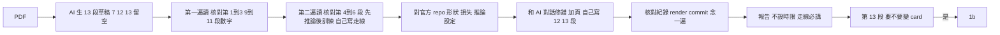

# 論文報告：把一篇論文變成投影片與講稿（v3.0，2026-10-22）

> 位置：貫穿各站。group meeting 的論文報告每週一人、partner 組內輪流（第 5 站 §7）。**不設時限**，教授當場控制：講清楚比講得短重要。
> 這一站的目的：報告一篇論文，讓聽的人知道它做了什麼、**方法怎麼推論、怎麼訓練**、數字可不可信、對我們有什麼用。重點是方法——你要能拿一個具體的輸入，從頭走到尾講完。
> 順序鐵律：**先講 inference，再講 training**。任何 AI 論文都一樣——先把推論的流程講清楚（一個輸入進去、經過哪些模組、怎麼變成輸出），聽的人腦中才有一條線可以掛東西；訓練是「這條線上的參數怎麼來的」，放在推論之後講才接得上。先講損失函數、再回頭講模型在做什麼，是最常見的講不清楚。
> 流程：**PDF 餵 AI → AI 產生 Quarto 投影片與講稿的草稿 → 你帶著草稿讀論文、逐頁核對 → 有官方 repo 就對回程式 → 和 AI 對話修正、需要的地方加頁 → 三段自己寫**。
> 產出：一份 Quarto 投影片（`.qmd` 與 render 出的 `.html`，**13 段、每段頁數不限**，每頁有講稿）＋一頁核對紀錄（Markdown，放自己 repo 的 `notes/papers/`，檔名同投影片：`〔會議〕_〔年份〕_〔第一作者的姓〕.md`）。
> 語言：**投影片本體一律英文**（標題、圖說、表格、條列），**講稿用繁體中文**。進度報告的投影片可以中文，論文報告不行——它是練習用英文講方法。
> 鐵律：**第 7 段走線的講稿、第 12 段我的判斷、第 13 段啟發，AI 不生，你自己寫。** 這三段是你讀懂與否的試金石；其餘十段 AI 生草稿、你核對。
> 頁數：13 段的內容與順序固定，**每段要幾頁就幾頁**。一頁講不清楚的——子模組的內部、多階段訓練、論文沒寫而程式裡才有的細節——就加頁、畫更清楚的圖，不要把字塞小（§3「什麼時候加頁」）。

---

## 0. 這一站怎麼接前後

- 論文從哪來：Round 1 的入門必讀、Round 2 §2 的盤點、Table 1 的 baseline 原論文、教授指定。原則：和 partner 組的議題相關
- 輸出到 1b：第 13 段「對我的題目的啟發」要說這篇能不能變成一張 idea card（來源 1 文獻 gap、4 跨領域移植、5 挑戰前提）
- 輸出到第 2 站：論文的實驗設定是你檢查「公平比較」的練習；它的主表是你 Table 1 的參考
- 投影片機制和第 5 站一樣用 Quarto，差異見 §4

---

## 1. 流程：六步



| 步 | 做什麼 | 花多久 |
|---|---|---|
| 1 餵 | 把 PDF 給 AI，貼 §4.3 的指令，拿到 `.qmd` 草稿；render 成 html 看一遍 | 30 分鐘 |
| 2 第一遍讀 | 對著草稿讀論文的摘要、所有圖表、結論；核對第 1–3 段與第 9–11 段的每個數字（§5） | 1 小時 |
| 3 第二遍讀 | 讀方法節，對著第 4–6 段的架構圖逐個模組、逐個符號核對；**先弄清楚推論怎麼走，再看訓練怎麼來**；**自己寫第 7 段走線的講稿** | 2–3 小時 |
| 4 對程式 | 有官方 repo 就必做（§5b）：找到每個模組的程式、釘 commit，核對形狀、損失與推論設定，論文沒寫的細節從這裡補。沒有官方 repo，在核對紀錄寫「無」，跳過 | 1–3 小時 |
| 5 修 | 核對有錯的，和 AI 對話修（§4.4）；一頁講不清楚的加頁、重畫圖（§3）；**自己寫第 12、13 段** | 1–2 小時 |
| 6 收 | 填核對紀錄（§2）、render、commit；講稿念一遍，記下大約要講多久 | 30 分鐘 |

第 3、4 步是重點。AI 生的走線講稿常常很像一回事，但形狀、query 的來源、訓練與推論的差異是錯的——這正是你自己寫那一段的原因；論文沒寫清楚的形狀，到程式裡找答案比猜可靠。卡住的公式、符號先問 AI（§6），AI 解釋完回論文對一次；還是不懂就記下來，報告時直接說「這裡我沒完全懂」，比裝懂好。

---

## 2. 核對紀錄

一頁 Markdown，`notes/papers/〔會議〕_〔年份〕_〔第一作者的姓〕.md`（例：`icassp_2026_lee.md`；arXiv 預印本用 `arxiv_2026_lee`）。它是你的核對清單，也是之後回頭看這篇論文時的摘要。每格標來源：`AI` 生的、`✓` 我核對過、`我` 自己寫的。

```markdown
# 〔論文標題〕
〔作者、會議／期刊、年份、URL〕 讀的日期：〔　〕

| 格 | 內容 | 來源 |
|---|---|---|
| 一句話 | 在〔任務〕上，〔方法〕讓〔主指標〕在〔資料集〕從〔A〕到〔B〕，代價是〔　〕 | AI→✓（對回表〔N〕） |
| 背景 | 〔原本的 pipeline，2–3 句〕 | |
| 痛點 | 〔一個具體的失敗例子〕 | |
| 架構 | 輸入〔　〕輸出〔　〕；模組〔　〕；新加的是〔　〕 | AI→✓（對回 §〔　〕） |
| 推論 | 輸入〔　〕→ 輸出〔　〕；一次出還是自回歸〔　〕；beam？〔　〕；推論時不用的模組〔　〕 | |
| 訓練 | 資料〔　〕損失〔　〕更新〔　〕凍結〔　〕；和推論哪裡不同〔　〕 | |
| 實作 | 官方 repo〔URL〕commit〔　〕；論文沒寫、程式才有的〔　〕；和論文不一致的〔　〕（沒有官方 repo 寫「無，找過〔哪些地方〕」） | ✓（§5b，每條附永久連結） |
| 走線 | 〔例子〕→〔模組 1：變成什麼〕→ ⋯ → 輸出 | **我** |
| 物理意義 | 新成分拿掉會怎樣〔　〕；位置〔　〕；成本〔　〕 | |
| 設定 | 資料集〔　〕指標〔　〕baseline〔　〕 | |
| 公平嗎 | 同 backbone？〔　〕同資料？〔　〕baseline 重跑還是引用？〔　〕seed？〔　〕 | ✓（翻實驗節） |
| 主結果 | 〔3–5 列〕；贏多少、哪裡贏最多、哪裡沒贏 | AI→✓（對回表〔N〕） |
| 消融 | 拿掉新成分掉多少（對回物理意義第一題） | |
| 賣點圖 | 〔哪張圖、它想證明什麼〕 | |
| 沒報的 | 〔推論速度？其他資料集？seed？〕 | |
| 我的判斷 | 最強〔　〕最弱〔　〕審稿人會問〔　〕 | **我** |
| 啟發 | 能借〔　〕；變 card？〔是：來源〔　〕，編號〔　〕／否：原因〕 | **我** |
| 沒把握 | 〔　〕 | |

## 修正紀錄（和 AI 對話改了什麼）
- 第〔N〕頁：AI 寫〔　〕，論文 §〔　〕寫的是〔　〕，已改
- 第〔N〕頁：AI 寫〔　〕，官方程式〔永久連結〕是〔　〕，已改
```

「修正紀錄」那段要留：它告訴教授你核對到什麼程度，也是你下次判斷「AI 在這類論文上常錯哪裡」的材料。

---

## 3. 投影片：13 段，每段頁數不限

13 段的內容與順序固定，每段**至少一頁**，要幾頁就幾頁；每頁都有講稿。投影片上的文字全英文，講稿中文。第 4–7 段的順序固定：架構 → 推論 → 訓練 → 走線，不要把訓練提前。

每段的**第一頁**標題逐字用下表的英文，放這一段的重點；同一段加的頁，標題寫成「段標題: 子題」，例如 `## Architecture: biasing module`、`## Training: stage 2 fine-tuning`。頁數再多，聽的人也知道現在講到哪一段；教授要你跳過時，你從下一段的第一頁接。

| 段 | 第一頁標題 | 內容 | 講稿 | 誰寫 |
|---|---|---|---|---|
| 1 | One-sentence claim | 核對紀錄的那一句；作者、會議、年份 | 為什麼挑這篇 | AI→核對 |
| 2 | Background | 原本的 pipeline，示意圖 | 原本怎麼做 | AI→核對 |
| 3 | Pain point | 在背景圖上標出壞掉的位置；一個具體失敗例子 | 這個例子為什麼錯 | AI→核對 |
| 4 | Architecture | 架構圖；新成分用不同框標出 | 輸入、輸出、每個模組一句 | AI→核對 |
| 5 | Inference | 同一張架構圖，只留推論時走的路徑 | 一個輸入怎麼變成輸出：一次出還是自回歸、有沒有 beam search、哪些模組推論時不用 | AI→核對 |
| 6 | Training | 同一張架構圖加損失與梯度流向；凍結的塗灰 | 資料從哪來、算什麼損失、更新什麼；和推論哪裡不同（teacher forcing、訓練才有的東西） | AI→核對 |
| 7 | Trace one example | 架構圖上標一個具體例子的中間狀態 | 這個例子經過每個模組變成什麼 | **我** |
| 8 | Why it works | 新成分拿掉會怎樣；位置；成本 | 你的推理，之後和消融表對 | AI→核對 |
| 9 | Setup and fairness | 資料集、指標、baseline；公平性四問的答案 | 哪裡不公平 | AI→核對 |
| 10 | Main results | 主表 3–5 列，關鍵數字加粗 | 贏多少、哪裡贏最多、哪裡沒贏 | AI→核對 |
| 11 | Ablation and key figure | 消融表幾列；賣點圖一張 | 消融有沒有驗證第 8 段的推理；圖想證明什麼 | AI→核對 |
| 12 | My assessment | 最強、最弱、審稿人會問 | — | **我** |
| 13 | Takeaways for my work | 能借什麼；要不要變 card | — | **我** |

### 什麼時候加頁

一頁講不清楚才加，一頁講一件事。常見的：

| 段 | 加什麼頁 | 標題例 |
|---|---|---|
| 4 架構 | 子模組放大：總圖上某一個框的內部，例如 cross-attention 的 Q、K、V 各從哪來、形狀多少 | `Architecture: biasing module` |
| 5 推論 | 一步一頁：自回歸解碼的某一步、beam search 怎麼剪枝、推論時的外部開關 | `Inference: one decoding step` |
| 6 訓練 | 多階段訓練一階段一頁；資料怎麼造（負樣本、資料增強）；損失的每一項 | `Training: stage 1 pre-training`、`Training: negative sampling` |
| 4–6 | 程式和論文對不上的地方，兩邊並列（§5b） | `Training: loss weight, paper vs. code` |
| 7 走線 | 一個模組一頁，形狀標在圖上 | `Trace one example: encoder` |
| 10–11 | 多個資料集各一張表；論文的分析圖 | `Main results: noisy test sets` |

不要加的：為了放更多字而拆頁（字太多要刪，不是拆）；論文沒寫、你推測的內容（放講稿的【提示】，標「我的推測」）；和這篇的主張無關的背景知識。

加頁不改變誰寫：第 7、12、13 段不管幾頁都自己寫；其他段加的頁可以請 AI 起草（§4.4），一樣要核對。

### 圖的規則

- 方法三段（4、5、6）的第一頁用**同一張架構圖**改三次，不要三張長得不一樣的圖：第 4 段全圖、第 5 段只留推論路徑、第 6 段加損失與梯度
- **放大圖**（子模組的內部、一個解碼步驟）：標題寫出放大的是哪個框，節點名稱和總圖一致；總圖上被放大的那個框加粗或換色，讓聽的人知道它在哪裡
- **論文有架構圖**：可以截圖，但必須加自己的標註——框出新成分、用箭頭標訓練與推論路徑、標走線例子的中間狀態。沒加標註的截圖不算。論文的圖太粗略、看不出你要講的東西，就自己重畫一張更清楚的，不要硬用
- **論文沒有架構圖**：§4.3 的指令本來就會用 Mermaid 畫三個版本；畫得不對就把方法節原文貼給 AI、照 §4.3 第 4–6 段的規則重畫一次，畫完對回論文的方法節，每個模組和符號都要對得上
- 畫法照 lab 的分工：框和箭頭用 Mermaid；不是框和箭頭的示意圖（attention 矩陣、張量形狀、音框和 token 的對齊）請 AI 寫 SVG，規格照第 5 站 §4.5（viewBox 寬 1100、字級 22 或 26），render 後自己看一次
- 實驗圖直接截論文的，標出要看的地方
- 每張圖標來源：「圖取自原論文 Fig. 2，標註為本人所加」；照程式畫的寫「依官方程式〔檔案〕繪製」

### 走線怎麼講

這是判斷你懂不懂的那一頁，所以講稿自己寫。拿論文自己的例子（通常在 introduction 或 figure 裡），或自己編一個最小的：一句話、一個 list、一個 batch。對每個模組講三件事：進去是什麼、出來是什麼、形狀或內容怎麼變。講得出「這句話進 encoder 之後是 T×D 的矩陣，biasing module 對它做 cross-attention，query 是 decoder 的 hidden state」就是懂了；只念模組名稱就是沒懂。

走線可以拆成多頁，一個模組一頁，形狀直接標在圖上。有官方 repo 的，形狀以程式為準（§5b）；論文和程式都沒寫的，才寫「我的推測」。

---

## 4. 用 Quarto 做

機制同第 5 站 §4（qmd → `quarto render` → html commit 進 `reports/`）。這裡補論文報告專用的部分。

### 4.1 檔案與 YAML

```
reports/
  icassp_2026_lee.qmd     〔會議〕_〔年份〕_〔第一作者的姓〕，全小寫
  icassp_2026_lee.html
  figs/                 截圖與自己畫的圖
```

YAML 固定用這段（`theme` 指向 `reports/theme.scss`，lab 的樣式表，範本 repo 已附，可用的類別見第 5 站 §4.4；1280×800 是以筆電螢幕為準的畫布；`include-after-body` 那段讓講稿裡的 LaTeX 在 presenter view 正常顯示——沒有它，presenter view 會把公式印兩次；`embed-resources: true` 讓 render 出的 html 是單一檔，reveal.js、樣式、圖都包在裡面，別人 clone 下來直接開得起來——沒有它，只有你自己的電腦看得到，因為 `_files/` 不進 git）：

```yaml
---
title: "〔論文短名〕"
subtitle: "〔作者，會議 年份〕"
author: "〔名字〕"
date: "〔YYYY-MM-DD〕"
format:
  revealjs:
    theme: [default, theme.scss]
    embed-resources: true
    width: 1280
    height: 800
    margin: 0.04
    slide-number: c/t
    center: false
    navigation-mode: linear
    html-math-method:
      method: katex
    include-after-body:
      - text: |
          <script>
          // 講稿（aside.notes）裡的數學只輸出 MathML，避免 presenter view 重複顯示
          (function () {
            var items = [];
            document.querySelectorAll('aside.notes .math').forEach(function (el) {
              items.push({ el: el, tex: el.textContent, display: el.classList.contains('display') });
              el.classList.remove('math');
            });
            document.addEventListener('DOMContentLoaded', function () {
              items.forEach(function (it) {
                katex.render(it.tex, it.el, { displayMode: it.display, output: 'mathml', throwOnError: false });
              });
            });
          })();
          </script>
---
```

qmd 裡放圖：``。第 1 段那句話包在 `::: {.claim}` 裡；圖的出處用 `[取自原論文 Fig. 2，標註為本人所加]{.cite}`；設定與公平性那張表前加 `::: {.prose}`。其他類別與兩條規則（一張最多四級、`.claim` 一張一次）見第 5 站 §4.4。

架構圖用 Mermaid 畫時，放在 Quarto 的 `{mermaid}` 區塊：區塊開頭寫 ```` ```{mermaid} ````，**大括號不能省**——寫成 ```` ```mermaid ```` 的話，Quarto 只會把它當程式碼原樣印出來。截圖存 PNG；自己畫、不是框和箭頭的圖存 SVG（做法見第 5 站 §4.5）。

### 4.2 講稿的格式

每一張 `##` 內容頁一段 `::: {.notes}`，固定兩塊：

```markdown
::: {.notes}
**【講述】**

可以直接照著念的口語段落。第一人稱。投影片上的每個數字、每個符號、每個模組都要講到它是什麼、從哪來。

**【提示】**

- 可能被問什麼、我打算怎麼答
- 我沒把握的地方（直接寫「這裡我不確定」）
- 這一頁的數字出處：論文表〔N〕、§〔　〕
- 來自官方程式的：〔永久連結〕
:::
```

`**【提示】**` 後面**一定要空一行**，不然清單會被併成一段文字。講稿裡的數學用 `$…$`，符號和投影片本體逐字一致。

### 4.3 請 AI 產生草稿

把 PDF 附上，整段複製。產出就是完整的 `.qmd`，存成 `reports/〔會議〕_〔年份〕_〔第一作者的姓〕.qmd` 後直接 `quarto render`；圖先用佔位檔名，§3 的圖規則做完再補進 `reports/figs/`。這份指令**只用 PDF**：程式在第 4 步另外查（§5b），查完、核對過，再請 AI 照表改（§4.4）。兩件事分開做，AI 才不會把它沒讀過的程式寫進草稿。

```
附件是一篇論文的 PDF。請產生一份 Quarto revealjs 投影片的 .qmd 完整原始檔（含 YAML），我會存成
reports/〔會議〕_〔年份〕_〔第一作者的姓〕.qmd 直接 render。

== YAML（逐字使用，只填 title／subtitle／author／date 四格）==
---
title: "〔論文短名〕"
subtitle: "〔第一作者 et al.，會議 年份〕"
author: "〔我的名字〕"
date: "〔今天 YYYY-MM-DD〕"
format:
  revealjs:
    theme: [default, theme.scss]
    embed-resources: true
    width: 1280
    height: 800
    margin: 0.04
    slide-number: c/t
    center: false
    navigation-mode: linear
    html-math-method:
      method: katex
    include-after-body:
      - text: |
          <script>
          (function () {
            var items = [];
            document.querySelectorAll("aside.notes .math").forEach(function (el) {
              items.push({ el: el, tex: el.textContent, display: el.classList.contains("display") });
              el.classList.remove("math");
            });
            document.addEventListener("DOMContentLoaded", function () {
              items.forEach(function (it) {
                katex.render(it.tex, it.el, { displayMode: it.display, output: "mathml", throwOnError: false });
              });
            });
          })();
          </script>
---

== 結構：13 段，順序固定。每段至少一頁，一頁講不清楚就加頁（一頁一件事，不要為了放更多字而拆頁）。每段第一頁的 ## 標題逐字用下面括號裡的英文；同一段加的頁，標題寫成「段標題: 子題」（例 ## Architecture: biasing module）。投影片本體（標題、內文、圖說、表格）一律英文 ==
1  一句話（## One-sentence claim）：「在〔任務〕上，〔方法〕讓〔主指標〕在〔資料集〕從〔A〕到〔B〕，代價是〔　〕」包在 ::: {.claim} 區塊裡；A、B 註明來自論文哪個表。下方一行作者、會議、年份、URL，加 {.cite}
2  背景（## Background）：原本的 pipeline 怎麼做，2–3 句；圖用  佔位
3  痛點（## Pain point）：原本的做法在哪個具體情況下壞掉；給一個論文裡有的失敗例子（輸入→錯成什麼）；圖用  佔位
4  架構（## Architecture）：先用文字列出節點與邊，再用 Mermaid flowchart LR 畫架構圖，放在 Quarto 的 {mermaid} 區塊（區塊開頭的語言標記寫 {mermaid}，大括號不能省，否則只會顯示成程式碼）；這篇新加的模組用 style 加粗邊框（stroke-width:4px）；
   邊上標資料的形狀（例 T×D）；節點標籤不含括號、引號、斜線。論文對某個子模組有細部說明（公式或子圖）時，加一頁 ## Architecture: 〔子模組英文名〕 畫它的內部，節點名稱和總圖一致
5  推論（## Inference）：同一張架構圖，只留推論時走的路徑，訓練才有的節點不畫；下方三行：輸入是什麼、輸出怎麼產生（一次出／自回歸、有沒有 beam search）、哪些模組推論時不用。先講推論再講訓練，順序不可對調
6  訓練（## Training）：同一張架構圖，加損失節點與梯度流向的邊；凍結的模組 style 填灰（fill:#ddd）；下方四行：資料從哪來、損失是什麼、更新哪些參數、和推論哪裡不同（teacher forcing、訓練才有的東西）。多階段訓練（例如先預訓練再微調）每一階段加一頁 ## Training: 〔階段〕
7  走線（## Trace one example）：只放標題與一行〔〕，其餘留空，講稿整段留〔〕。這段我自己寫，你只放這一頁
8  物理意義（## Why it works）：三行——新成分拿掉會怎樣、為什麼放這個位置、參數量或計算量佔多少；論文沒寫的標「論文未說明」
9  設定與公平性（## Setup and fairness）：兩欄表（前面加 ::: {.prose}）——資料集、指標、baseline；然後四問各一行：同 backbone？同資料？baseline 重跑還是引用？多 seed？論文沒寫的寫「論文未說明」
10 主結果（## Main results）：主表只留 3–5 列（baseline 與提案方法），關鍵數字加粗；表格下方註明「取自論文表 N」
11 消融與賣點圖（## Ablation and key figure）：消融表幾列（拿掉新成分掉多少）；賣點圖用  佔位，下方一行它想證明什麼；最後一行「沒報的東西：〔推論速度／其他資料集／seed〕」
12 我的判斷（## My assessment）：只放三個項目的標題（Strongest point／Weakest point／What a reviewer would ask），內容留〔〕，講稿留〔〕。這段我自己寫，你只放這一頁
13 對我的題目的啟發（## Takeaways for my work）：只放兩個項目的標題（What to borrow／Idea card?），內容留〔〕，講稿留〔〕。這段我自己寫，你只放這一頁

== 講稿：每頁一段 ::: {.notes}，格式逐字如下 ==
::: {.notes}
**【講述】**

口語、第一人稱、可以照念的完整段落。投影片上每個數字、符號、模組都要講到它是什麼、從哪來；
數學用 $…$，符號和投影片本體逐字一致。

**【提示】**

- 這頁的出處：論文第幾節、表幾、圖幾
- 可能被問的問題與我打算怎麼答
:::
**【提示】** 後面一定要空一行再接 bullet。第 7、12、13 段的講稿整段只寫〔〕。

== 硬規定 ==
- 只用 PDF 裡有的內容。PDF 沒寫的留〔〕並標「論文未說明」，不要補、不要推測、不要替我下結論
- 不要寫任何程式的檔名、函式名稱或行號；程式的部分我之後另外查
- 第 7、12、13 段不寫內容也不寫講稿，就算你覺得寫得出來
- 每個數字後面註明出處（表幾／第幾節）；每張截圖佔位的說明文字要含「取自原論文 Fig. N」
- 第 4、5、6 段的第一頁是同一張圖改三次，節點名稱三張要一致；加的放大圖節點名稱也和總圖一致
- 投影片本體全部英文；講稿（::: {.notes} 內）用繁體中文（臺灣用語），專有名詞保留英文
- 樣式只用 YAML 裡的 theme，不要在 qmd 裡寫 CSS、不要用 {.smaller}；可用的類別只有 .claim（含 .warn／.ok）、.cite、.prose、.wrap、.small、.meta、.metrics、.tag，而且 .claim 一頁最多一個
- 輸出單一 .qmd 的完整內容，從第一行 --- 到最後一頁的 :::，不要加任何說明文字
```

拿到檔案後先 render 一次看有沒有語法錯；然後照 §1 的第 2–5 步核對、對程式、補圖、加頁、自己寫三段。

### 4.4 和 AI 對話修正

核對到錯的地方，這樣問才改得準：

- **指出位置與依據**：「第 6 段的講稿說損失是 CTC，論文 §3.2 第二段寫的是 CTC 與 attention 的加權和，權重 0.3，請改第 6 段的講稿與圖」
- **一次改一處**，改完看一次再改下一處；一次丟十個錯 AI 會漏
- **不要說「這頁怪怪的」**——它會重寫整頁，連對的也改掉
- **形狀與符號對不上時，把論文的符號表貼給它**：「論文定義 H 是 T×D，你寫成 D×T」
- **用程式修**：把 §5b 核對過的對照表貼給它，只貼你點開連結讀過的那幾列：「依這張表改第 6 段：損失權重以程式為準，並加一頁 Training: loss weight, paper vs. code，兩邊並列、標出處」
- **要加頁，說清楚放哪一段、講哪件事、依據什麼**：「第 4 段加一頁 Architecture: biasing module，照論文 §3.2 式 (3)–(5) 畫 cross-attention 的內部，Q 來自 decoder、K 與 V 來自 biasing encoder，節點名稱和第 4 段的總圖一致」
- AI 改完你再對一次論文。改了三次還不對的，自己改 qmd，不要再問

每改一處，在核對紀錄的「修正紀錄」加一行。

---

## 5. 核對清單

| 段 | 對什麼 | 對回論文哪裡 |
|---|---|---|
| 1 | A、B 兩個數字 | 主表的表號與列 |
| 2–3 | 背景的 pipeline、失敗例子 | introduction 或 related work；例子要論文有的 |
| 4 | 每個節點 | 方法節的段落或公式編號；對不到的刪掉 |
| 5 | 推論的路徑、輸出方式、推論時不用的模組 | 方法節或實驗設定；論文沒寫就標「論文未說明」 |
| 6 | 損失、更新與凍結的參數；和推論的差異 | 方法節的訓練小節或實驗設定 |
| 7 | 走線的每個形狀 | 符號表；有官方 repo 以程式為準（§5b）；兩邊都沒寫的寫「論文未明說，我的推測」 |
| 8 | 拿掉會怎樣 | 之後和第 11 段的消融表對 |
| 9 | 公平性四問 | 實驗設定節；找不到也是答案 |
| 10–11 | 每個數字、每張圖 | 表號、圖號 |
| 加的頁 | 同它所屬的段；放大圖的節點名稱對總圖 | 同它所屬的段 |
| 標 Code 的 | 每個永久連結自己點開、那幾行自己讀過 | 程式（§5b） |

全部對完才算第 2、3 步做完；程式的部分見 §5b。

---

## 5b. 對程式：有官方 repo 就必查

論文的篇幅有限：張量的形狀、損失怎麼加權、正規化放在哪、資料怎麼前處理、推論時的 beam size 與各種權重，常常只寫在程式裡。這些正是 AI 草稿最常錯、你自己最容易猜錯的地方。作者釋出的程式是最接近「實際怎麼做」的證據，所以**有官方 repo 就一定要對**。

### 5b.1 找 repo、釘版本

- **官方**＝作者或作者的機構釋出的。去哪找：摘要結尾或第一頁腳註的連結、實驗節或結論的 code availability 句子、作者的 GitHub 或個人頁；都沒有，就在 GitHub 搜論文標題或方法名，確認擁有者是作者
- 找不到：核對紀錄的「實作」格寫「無官方 repo（找過：〔哪些地方〕）」，這一節就結束
- **第三方實作**（toolkit 的 recipe，例如 ESPnet、NeMo、SpeechBrain；或別人的重現）可以參考，不是必查；用了要標「第三方實作」，而且不能拿它推翻論文——它自己可能就是錯的
- **釘 commit**：repo 會改，「main 分支第 88 行」下個月就不是同一行。記下你讀的 commit hash；引用一律用帶 commit 的永久連結（GitHub 看檔案時按 `y`，網址會換成帶 commit 的版本）。README 若標了對應論文的 tag 或 branch，讀那一版

### 5b.2 對什麼

| 段 | 在程式裡找 |
|---|---|
| 4 架構 | 每個模組對應哪個 class 或函式；新成分實際的層數、維度 |
| 5 推論 | 推論的進入點（decode、generate、inference 之類的函式）；beam size 與各種權重的預設值；推論時跳過哪些模組 |
| 6 訓練 | 損失怎麼組合、權重多少；哪些參數凍結（`requires_grad = False`）；optimizer 與學習率排程；訓練才有的東西（資料增強、負樣本怎麼抽） |
| 7 走線 | forward 裡每一步的張量形狀 |
| 9 設定 | config 檔的超參數和論文的表對不對得上 |

### 5b.3 請 AI 找

AI 工具能讀 GitHub，就把網址給它；不能的話，把 repo clone 下來，用 AI 寫程式的工具在本機讀。整段複製：

```
這是一篇論文的官方程式：〔repo URL〕，commit〔hash〕。論文 PDF 附上。
請在這個 repo 裡找出下面每一項對應的程式，做成一張 Markdown 表：
| 項目 | 檔案與行號（帶 commit 的 GitHub 永久連結） | 程式怎麼做 | 論文怎麼寫（第幾節、式幾） | 一致？ |

項目：
1 每個模組對應的 class 或函式（照論文的架構圖逐個列）
2 推論的進入點、beam size 與其他推論時的權重或開關、推論時跳過的模組
3 損失的組合與權重、凍結的參數、optimizer 與學習率排程
4 forward 裡新成分每一步的張量形狀
5 config 檔裡和論文實驗設定不同的超參數
6 〔我自己卡住的問題，例：biasing 的 context 和 decoder 輸出是相加還是 concat〕

規定：
- 只寫你在程式裡實際找到的；找不到就在那一格寫「找不到」，不要推測，不要編檔名或行號
- 「一致？」只填：一致／不一致／論文沒寫
- 不要改寫或總結論文，只做對照
```

### 5b.4 怎麼核對

AI 給的檔名、函式、行號都要你**自己點開、自己讀那幾行**——它常給錯行號、指到別的 branch，甚至給不存在的函式。沒點開過的，不能上投影片，也不能寫進核對紀錄。

程式跑得起來的話，拿一個最小的輸入跑一次 forward，把每個模組的輸出形狀印出來，是走線最直接的核對。這一步選做：裝了半天跑不起來就停，不影響報告。

### 5b.5 程式和論文對不上

很常見，而且是好材料：

- 投影片上**兩邊並列**，各標出處，例如「Paper (§3.2): weight 0.3」「Code (`train.py#L142` @〔commit〕): weight 0.5」；放在那一段加的一頁，或那一頁的下半
- 講稿說你判斷論文的數字是用哪一個跑出來的、根據什麼（README 的說明、config 的預設值、repo issue 裡作者的回覆）；判斷不了就直說
- 寫進核對紀錄「實作」格的「和論文不一致的」
- 它常常就是第 12 段「審稿人會問」的一條：reproducibility

### 5b.6 怎麼放上投影片

- 來自程式的事實，在頁上用 `[Code: 〔檔案〕#L〔行〕 @〔commit 前 7 碼〕]{.cite}` 標出處，講稿【提示】附完整的永久連結
- 不要整段貼程式碼。要貼只貼關鍵的幾行（10 行以內）；多數時候畫成圖、寫成形狀，比貼程式清楚
- 放進它所屬的段（架構的細節進第 4 段、損失進第 6 段），不另開一段

---

## 6. AI 怎麼用

可以：
- 生 13 段的草稿（§4.3）；起草加的頁、改錯（§4.4）
- 解釋看不懂的段落、公式、符號；解釋完回論文對一次
- 畫架構圖與放大圖的草稿
- 在官方 repo 裡找模組、損失、形狀對應的程式（§5b）；每個連結自己點開讀過
- 問「這個方法和〔另一篇〕差在哪」當第二意見，但答案要自己驗證

不可以：
- 讓 AI 寫第 7、12、13 段。指令裡已經規定留空；它若還是寫了，刪掉重寫
- 把 AI 的解釋當成論文說的；論文說的以論文為準
- 把 AI 給的程式檔名、行號，沒點開就放上投影片
- 跳過 §5、§5b 的核對直接報告。草稿通順不代表正確，AI 最常錯的正是形狀、損失的組合、訓練與推論的差異

---

## 7. 講的時候

- 不設時限，教授當場控制。開場說一句這次有幾頁、大約講多久（第 6 步念過一遍就知道）
- 教授說跳過時，從下一段的第一頁接；所以每段的第一頁要能單獨講完這一段的重點，加的頁是細節
- 走線一定講，就算要跳過別的
- 數字只講加粗的；一張表不要逐格念
- 看不懂的地方直接說「這裡我沒完全懂，我的理解是⋯」。教授和 partner 可能知道
- 第 12 段的「審稿人會問」要是真的問題，不是「資料集可以再多」這種萬用句

---

## 8. 示例

> **示例，內容虛構。** 延續 contextual biasing STT；示範第 7 段走線的講稿——這一段要你自己寫，長這樣。

```
**【講述】**

我拿一句話走一遍。音檔是「please call Hsin-Yi」，biasing list 是三個詞：Hsin-Yi、Shin-Yi、Cindy。
音檔先進 encoder，切成 T 個 frame，出來是 T×D 的矩陣，每一列是一個 frame 的表示。
list 裡三個詞各編成一個 D 維向量，所以 biasing encoder 的輸出是 3×D。
decoder 走到要輸出人名那一步時，它的 hidden state 當 query，對那 3×D 做 attention，
得到一個 D 維的 context 向量——「偏向」就發生在這裡。
這個 context 和原本的 decoder 輸出接在一起、再投影回 D 維，過 softmax 之後 Hsin-Yi 的機率被拉高，輸出就是「please call Hsin-Yi」。
訓練時 list 是從該句的參考文字抽出真實人名再混入干擾詞；推論時 list 由使用者給，decoder 是自回歸的，沒有 teacher forcing。

**【提示】**

- 可能被問：干擾詞怎麼抽？論文 §3.3：從訓練集的詞表隨機抽，比例 1:10
- 合併方式：論文 §3.2 沒寫是相加還是 concat；官方程式 `model/biasing.py#L88` @〔commit〕 是 concat 後過一層 Linear 投影回 D 維，我照程式講（§5b）
```

---

## 9. 淺讀：每週 2 篇、每篇 5 行

深讀（上面那套）每三週一次；**淺讀每週 2 篇**，不做投影片，只在 `notes/papers/reading_log.md` 記 5 行：

```markdown
## 〔YYMMDD〕 〔會議_年份_姓〕 〔標題〕 〔URL〕
- 主張：在〔任務〕上〔方法〕讓〔指標〕從 A 到 B
- 動了哪一格：〔新成分／架構／學習方式／損失〕
- 和我的題目的關係：〔可借／是 baseline／無關但有趣〕
- 值得深讀？〔是／否，一句理由〕
```

來源：Round 2 §2 的盤點清單、Scholar alert 送來的、partner 推薦的。半年一百篇淺讀，是「想法越來越實際」真正的來源；深讀訓練的是講清楚，淺讀累積的是品味。進度報告第 8 頁多一行「本週讀了：〔2 篇的短名〕」。

## 10. 審稿預測練習（每三次論文報告輪一次）

讀接受的論文只學得到「好的長什麼樣」，學不到「為什麼被拒」。ICLR 的審稿在 OpenReview 全公開，是免費的教材。每三次論文報告，輪到的人改做這個：

1. 到 OpenReview 挑一篇同領域、**有完整審稿**的 ICLR 投稿（接受或拒絕都可以），只看論文不看審稿
2. 照上面 13 段做一份**精簡版**：只做第 1、4、9、10、12 段
3. 第 12 段改成三行預測：會不會收、最大的問題是什麼、平均分數大約幾分
4. 報完當場開審稿，對答案：你抓到的問題審稿人有沒有提？審稿人提的你有沒有漏？
5. 把「漏掉的那一類問題」記進 `reading_log.md` 最上面的一段「我容易漏的」

半年六次之後，你對「什麼叫貢獻不夠」的感覺會比讀三十篇接受論文來得快。

## 10b. 審稿人會怎麼看這一站的產出

這一站整個就是在練審稿人的眼睛：
- 第 9 段公平性四問、第 11 段「沒報的東西」、第 12 段「審稿人會問」——你對別人的論文問的，就是審稿人會對你的論文問的；問熟了，自己寫的時候會先堵
- §10 審稿預測練習直接對答案：你抓到的問題審稿人提了沒、審稿人提的你漏了什麼。漏的那一類記進 reading_log「我容易漏的」，那是你未來論文最可能被打的地方
- 第 13 段啟發裡「能借什麼」常常是「這篇怎麼說服審稿人的」——分析圖的畫法、消融的設計、代價怎麼報，都可以借
- §5b 程式和論文對不上的地方，正是 reproducibility 會被問的地方。反過來看你自己：論文寫的每個設定，你的程式和 config 都要對得上（第 3＋4 站）

---

## 11. 要問教授的事

| 問題 | 什麼時候問 |
|---|---|
| 這篇值得報嗎，還是有更該報的？ | 選定後、餵 AI 之前 |
| 方法節這一段我和 AI 的解釋對不上，哪個對？ | 第 3 步卡住時；先問 partner |
| 我的「審稿人會問」問得對嗎？ | 報完當場問 |
| 這篇要不要變成 card？ | 第 13 段報完，教授當場答 |

---

## 修改紀錄

### v3.0（2026-10-22）
- 拿掉頁數限制（使用者定）：13 段的內容與順序不變，每段頁數不限；每段第一頁用固定的英文標題，加的頁寫「段標題: 子題」。§3 加「什麼時候加頁」，圖的規則加放大圖與畫法分工；全文「第 N 頁」改「第 N 段」
- 拿掉時間限制（使用者定）：不設時限，教授當場控制；刪掉 20 分鐘、方法 8 分鐘與各頁分鐘數（開頭、§1、§3、§4.2、§4.3 指令、§7、§8、§10）。§7 改為每段第一頁要能單獨講完，教授說跳過時從下一段接
- 加 §5b 對程式（使用者定：有官方 repo 就必查）：找 repo、釘 commit、對什麼、請 AI 找的指令、怎麼核對、程式和論文對不上怎麼辦、怎麼放上投影片。流程改為六步；§2 核對紀錄加「實作」格；§4.3 草稿指令維持只用 PDF，程式在第 4 步另外查；§4.4、§5、§6、§8 示例、§10b 同步
- §4.4 例句的「第 5 頁」改為第 6 段（v2.5 對調推論與訓練時漏改）
- 範本 `_template_paper.qmd`、`notes/papers/_template.md` 同步

### v2.6（2026-10-16）
- YAML 加 `embed-resources: true`（§4.1、§4.3 指令、範本 `_template_paper.qmd`）：原本漏了，html 依賴不進 git 的 `_files/`，別人 clone 下來開不起來
- §4.1、§4.3：Mermaid 一律放 `{mermaid}` 區塊，大括號不能省；圖的格式：截圖 PNG、自己畫的非框箭頭圖 SVG

### v2.5（2026-10-12）
- 第 5、6 頁對調：**先 Inference 再 Training**（使用者定：任何 AI 論文先把推論流程講清楚，再講訓練原理）；開頭加順序鐵律，§1 流程圖與第 3 步、§2 核對紀錄、§3 頁表、§4.3 指令、§5 核對清單同步；範本 `_template_paper.qmd`、`notes/papers/_template.md` 同步
- 加樣式表：YAML 加 `theme: [default, theme.scss]`（正本在範本 repo 的 `reports/`），§4.1 補第 1 頁用 `.claim`、出處用 `.cite`、公平性表用 `.prose`；§4.3 指令改為只能用 theme 提供的類別，不自己寫樣式；類別清單在第 5 站 §4.4

### v2.4（2026-10-08）
- 加 §10b「審稿人會怎麼看這一站的產出」

### v2.3（2026-10-08）
- §1 加五步流程圖

### v2.2（2026-10-08）
- 修兩處殘留：「論文卡」→「核對紀錄」；「請 AI 畫（§4.2）」→ 指向 §4.3
- 加 §9 淺讀 log（每週 2 篇 5 行）與 §10 審稿預測練習（OpenReview，每三次論文報告輪一次）；原 §9 改 §11

### v2.1（2026-10-08）
- 投影片本體一律英文、講稿中文；13 頁的英文標題固定；§4.3 指令同步
- §4.3 指令改為自足版：含 YAML、檔名、每頁內容規格、圖的佔位與 Mermaid 規則、講稿格式與分鐘數；AI 輸出即可直接 render
- 檔名改為 `〔會議〕_〔年份〕_〔第一作者的姓〕`（投影片與核對紀錄同名）

### v2（2026-10-07）
- 流程改為「PDF 餵 AI 生草稿 → 帶著草稿讀論文核對 → 和 AI 對話修正」；第 7、12、13 頁規定 AI 不生、學生自己寫
- 論文卡改為核對紀錄，每格標來源（AI／核對過／自己寫），加「修正紀錄」
- §4 補固定 YAML（1280×800、講稿數學 MathML 腳本）、講稿【講述】＋【提示】格式、附 PDF 的 AI 指令、和 AI 對話修正的方法
- §5 核對清單逐頁列「對回論文哪裡」

### v1（2026-10-07）
- 初版。固定 13 頁、方法 8 分鐘、走線必講；方法三張圖用同一張架構圖改三次；論文有架構圖可截圖但必加自己的標註，沒有就自己畫或請 AI 畫；先填論文卡再做投影片；結尾兩頁「我的判斷」「對我的題目的啟發」接回 1b
